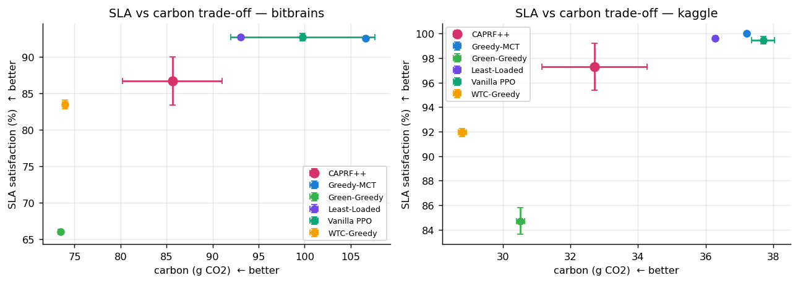
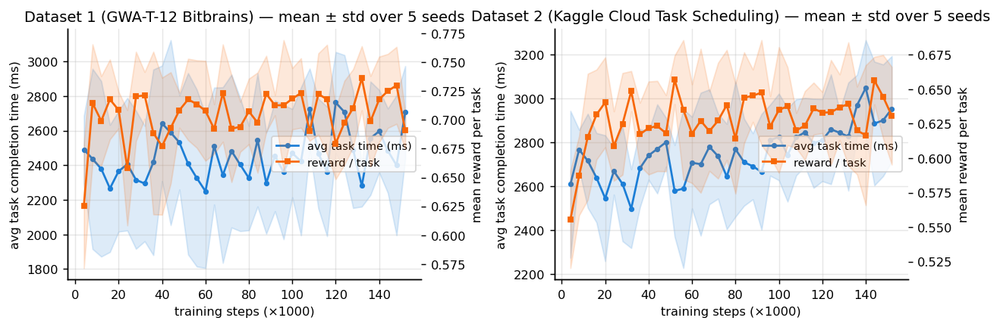
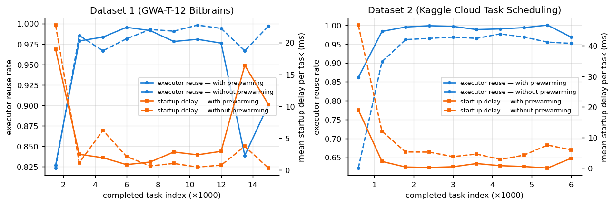
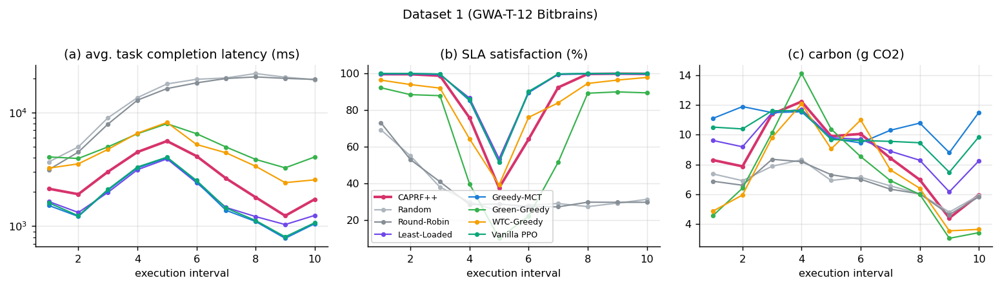
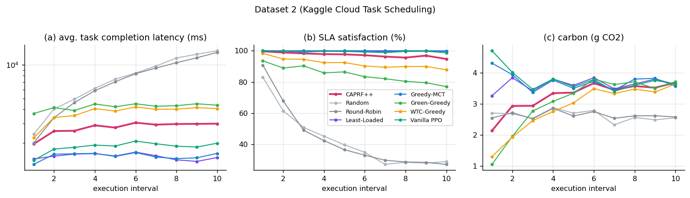
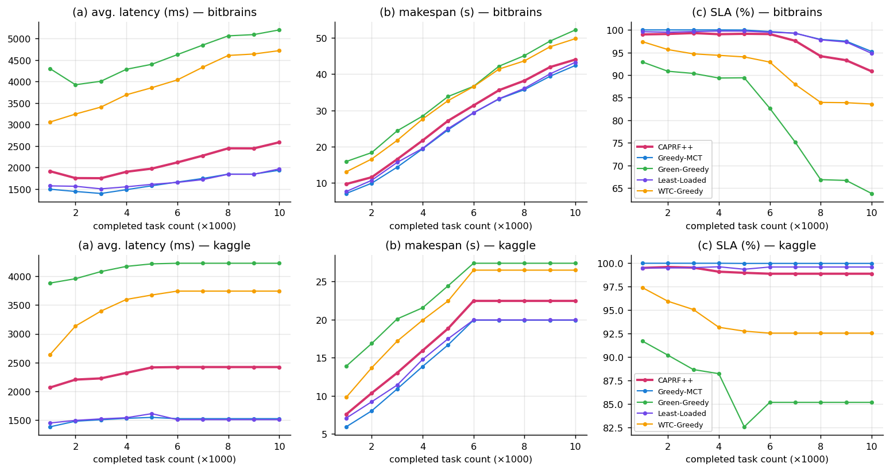
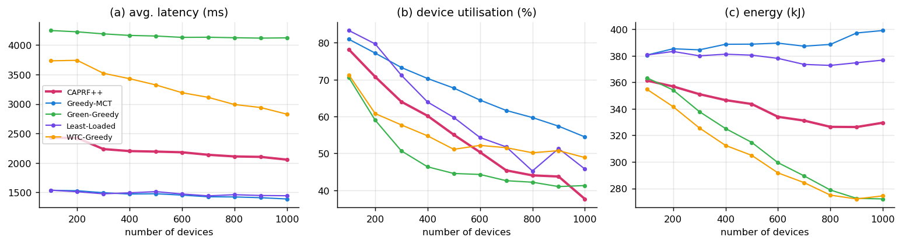
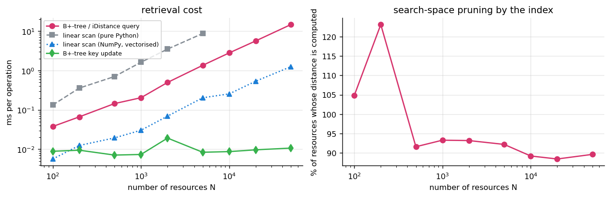

# CAPRF++ — experimental results

Generated by `python -m caprf.experiments.analyze` from 5 seed(s) per configuration.
All numbers come from our simulator (Sec. 4.1 of the paper, parameters of Tables 1-2) driven by the two
datasets; they are **not** expected to equal the paper's numbers. Reductions are relative to
Least-Loaded (no sustainability objective, no prewarming), as in Sec. 4.3.1.

**Seeds.** A seed changes the randomness only: initial network weights, the training episodes drawn and
their load, exploration, UNK/replay sampling, iDistance reference points, and the simulator's runtime noise.
The workload, held-out task types, cluster hardware and hyper-parameters are identical across seeds.
Baselines are deterministic rules, so only runtime noise varies for them, hence their tiny ± values.

## Table 3 — CAPRF++ on both datasets (mean ± std over seeds)
| Metric                                 | Dataset 1 (GWA-T-12 Bitbrains)   | Dataset 2 (Kaggle Cloud Task Scheduling)   |
|:---------------------------------------|:---------------------------------|:-------------------------------------------|
| Avg. task completion latency (ms)      | 2873 ± 443                       | 2756 ± 539                                 |
| SLA satisfaction (%)                   | 86.7 ± 3.3                       | 97.3 ± 1.9                                 |
| Carbon footprint reduction (%)         | 8.0 ± 5.8                        | 9.8 ± 4.2                                  |
| Cold-start overhead reduction (%)      | 91.8 ± 6.5                       | 89.5 ± 7.5                                 |
| Generalization on unseen workloads (%) | 100.0 ± 0.0                      | 98.6 ± 2.1                                 |
| Makespan (s)                           | 68.8 ± 2.3                       | 24.5 ± 2.5                                 |

## Table 4 — comparison on Dataset 1 (GWA-T-12 Bitbrains)
| Scheduler    | Latency (ms)   | SLA (%)    | Carbon (g CO2)   | Carbon red. (%)   | Energy (kJ)   | Cold-start red. (%)   | Executor reuse (%)   | Generalization (%)   | Makespan (s)   |
|:-------------|:---------------|:-----------|:-----------------|:------------------|:--------------|:----------------------|:---------------------|:---------------------|:---------------|
| CAPRF++      | 2873 ± 443     | 86.7 ± 3.3 | 85.7 ± 5.4       | 8.0 ± 5.8         | 944 ± 25      | 91.8 ± 6.5            | 97.8 ± 1.9           | 100.0 ± 0.0          | 68.8 ± 2.3     |
| Random       | 15125 ± 23     | 36.1 ± 0.1 | 67.9 ± 0.1       | 27.1 ± 0.1        | 866 ± 1       | -22.2 ± 1.2           | 70.1 ± 0.0           | 100.0 ± 0.0          | 137.0 ± 1.7    |
| Round-Robin  | 14342 ± 60     | 36.7 ± 0.1 | 67.1 ± 0.1       | 27.9 ± 0.1        | 861 ± 1       | -22.5 ± 1.4           | 70.3 ± 0.0           | 93.7 ± 0.4           | 123.3 ± 1.9    |
| Least-Loaded | 1939 ± 12      | 92.7 ± 0.1 | 93.1 ± 0.1       | 0.0 ± 0.0         | 993 ± 1       | 0.0 ± 0.0             | 76.1 ± 0.3           | 99.0 ± 0.4           | 66.0 ± 0.4     |
| Greedy-MCT   | 1886 ± 4       | 92.6 ± 0.1 | 106.6 ± 0.2      | -14.6 ± 0.2       | 1050 ± 1      | 78.0 ± 0.1            | 94.2 ± 0.1           | 98.6 ± 0.1           | 64.9 ± 0.1     |
| Green-Greedy | 5025 ± 14      | 66.0 ± 0.3 | 73.5 ± 0.2       | 21.1 ± 0.2        | 889 ± 2       | 66.8 ± 0.5            | 91.0 ± 0.2           | 99.4 ± 0.8           | 74.3 ± 0.2     |
| WTC-Greedy   | 4436 ± 29      | 83.5 ± 0.6 | 73.9 ± 0.3       | 20.6 ± 0.3        | 887 ± 2       | 83.5 ± 0.2            | 95.6 ± 0.0           | 100.0 ± 0.0          | 69.9 ± 0.4     |
| Vanilla PPO  | 1930 ± 45      | 92.7 ± 0.5 | 99.8 ± 7.8       | -7.2 ± 8.4        | 1015 ± 42     | 82.8 ± 1.7            | 95.7 ± 0.5           | 98.6 ± 1.0           | 65.1 ± 0.3     |

## Table 5 — comparison on Dataset 2 (Kaggle Cloud Task Scheduling)
| Scheduler    | Latency (ms)   | SLA (%)     | Carbon (g CO2)   | Carbon red. (%)   | Energy (kJ)   | Cold-start red. (%)   | Executor reuse (%)   | Generalization (%)   | Makespan (s)   |
|:-------------|:---------------|:------------|:-----------------|:------------------|:--------------|:----------------------|:---------------------|:---------------------|:---------------|
| CAPRF++      | 2756 ± 539     | 97.3 ± 1.9  | 32.7 ± 1.6       | 9.8 ± 4.2         | 361 ± 9       | 89.5 ± 7.5            | 96.4 ± 3.1           | 98.6 ± 2.1           | 24.5 ± 2.5     |
| Random       | 8046 ± 26      | 42.7 ± 0.2  | 26.2 ± 0.0       | 27.7 ± 0.1        | 334 ± 1       | -37.0 ± 1.3           | 62.0 ± 0.0           | 97.4 ± 0.4           | 60.6 ± 1.2     |
| Round-Robin  | 7551 ± 35      | 43.3 ± 0.3  | 26.4 ± 0.0       | 27.4 ± 0.1        | 335 ± 0       | -41.1 ± 1.3           | 60.9 ± 0.0           | 100.0 ± 0.0          | 50.6 ± 0.8     |
| Least-Loaded | 1515 ± 14      | 99.6 ± 0.1  | 36.3 ± 0.1       | 0.0 ± 0.0         | 384 ± 1       | 0.0 ± 0.0             | 73.0 ± 0.3           | 99.9 ± 0.1           | 20.3 ± 0.4     |
| Greedy-MCT   | 1529 ± 3       | 100.0 ± 0.0 | 37.2 ± 0.0       | -2.5 ± 0.1        | 385 ± 0       | 56.7 ± 0.7            | 87.7 ± 0.2           | 100.0 ± 0.0          | 19.7 ± 0.1     |
| Green-Greedy | 4229 ± 7       | 84.7 ± 1.1  | 30.5 ± 0.1       | 15.9 ± 0.2        | 354 ± 1       | 38.9 ± 0.8            | 82.3 ± 0.2           | 99.8 ± 0.3           | 27.5 ± 0.1     |
| WTC-Greedy   | 3746 ± 6       | 91.9 ± 0.3  | 28.8 ± 0.1       | 20.6 ± 0.3        | 342 ± 1       | 67.1 ± 0.3            | 90.4 ± 0.1           | 99.6 ± 0.6           | 26.5 ± 0.2     |
| Vanilla PPO  | 1854 ± 123     | 99.4 ± 0.3  | 37.7 ± 0.3       | -3.9 ± 0.9        | 389 ± 2       | 44.8 ± 42.0           | 84.7 ± 11.8          | 100.0 ± 0.0          | 20.7 ± 0.3     |

## Table 6 — Wilcoxon signed-rank tests
`p_intervals`: paired over 10 execution intervals × seeds (one-sided, direction in *hypothesis*).
`p_seeds_two_sided`: paired over seeds only; with 5 pairs the exact two-sided minimum is 0.0625.

|    | dataset   | baseline     | metric     | hypothesis                    |   caprf_mean |   baseline_mean |   n_intervals |   p_intervals |   n_seeds |   p_seeds_two_sided | significant_0_05   |
|---:|:----------|:-------------|:-----------|:------------------------------|-------------:|----------------:|--------------:|--------------:|----------:|--------------------:|:-------------------|
|  0 | bitbrains | Greedy-MCT   | latency_ms | CAPRF++ less than baseline    |     2872.52  |        1885.85  |            50 |      1        |         5 |              0.0625 | False              |
|  1 | bitbrains | Greedy-MCT   | sla        | CAPRF++ greater than baseline |       86.729 |          92.576 |            50 |      1        |         5 |              0.0625 | False              |
|  2 | bitbrains | Greedy-MCT   | carbon_g   | CAPRF++ less than baseline    |        8.55  |          10.662 |            50 |      6.03e-07 |         5 |              0.0625 | True               |
|  3 | bitbrains | Greedy-MCT   | cold_ms    | CAPRF++ less than baseline    |        2.579 |           6.924 |            50 |      3.18e-06 |         5 |              0.0625 | True               |
|  4 | bitbrains | WTC-Greedy   | latency_ms | CAPRF++ less than baseline    |     2872.52  |        4436.06  |            50 |      8.88e-16 |         5 |              0.0625 | True               |
|  5 | bitbrains | WTC-Greedy   | sla        | CAPRF++ greater than baseline |       86.729 |          83.465 |            50 |      9.29e-05 |         5 |              0.125  | True               |
|  6 | bitbrains | WTC-Greedy   | carbon_g   | CAPRF++ less than baseline    |        8.55  |           7.395 |            50 |      1        |         5 |              0.0625 | False              |
|  7 | bitbrains | WTC-Greedy   | cold_ms    | CAPRF++ less than baseline    |        2.579 |           5.181 |            50 |      1.18e-06 |         5 |              0.125  | True               |
|  8 | bitbrains | Green-Greedy | latency_ms | CAPRF++ less than baseline    |     2872.52  |        5025.44  |            50 |      8.88e-16 |         5 |              0.0625 | True               |
|  9 | bitbrains | Green-Greedy | sla        | CAPRF++ greater than baseline |       86.729 |          66.017 |            50 |      8.88e-16 |         5 |              0.0625 | True               |
| 10 | bitbrains | Green-Greedy | carbon_g   | CAPRF++ less than baseline    |        8.55  |           7.347 |            50 |      1        |         5 |              0.0625 | False              |
| 11 | bitbrains | Green-Greedy | cold_ms    | CAPRF++ less than baseline    |        2.579 |          10.461 |            50 |      1.15e-11 |         5 |              0.0625 | True               |
| 12 | kaggle    | Greedy-MCT   | latency_ms | CAPRF++ less than baseline    |     2756.32  |        1528.57  |            50 |      1        |         5 |              0.0625 | False              |
| 13 | kaggle    | Greedy-MCT   | sla        | CAPRF++ greater than baseline |       97.28  |          99.993 |            50 |      1        |         5 |              0.0625 | False              |
| 14 | kaggle    | Greedy-MCT   | carbon_g   | CAPRF++ less than baseline    |        3.259 |           3.72  |            50 |      1.74e-07 |         5 |              0.0625 | True               |
| 15 | kaggle    | Greedy-MCT   | cold_ms    | CAPRF++ less than baseline    |        3.7   |          15.176 |            50 |      3.3e-13  |         5 |              0.0625 | True               |
| 16 | kaggle    | WTC-Greedy   | latency_ms | CAPRF++ less than baseline    |     2756.32  |        3745.7   |            50 |      8.88e-16 |         5 |              0.0625 | True               |
| 17 | kaggle    | WTC-Greedy   | sla        | CAPRF++ greater than baseline |       97.28  |          91.947 |            50 |      2.66e-15 |         5 |              0.0625 | True               |
| 18 | kaggle    | WTC-Greedy   | carbon_g   | CAPRF++ less than baseline    |        3.259 |           2.88  |            50 |      1        |         5 |              0.0625 | False              |
| 19 | kaggle    | WTC-Greedy   | cold_ms    | CAPRF++ less than baseline    |        3.7   |          11.511 |            50 |      3.82e-14 |         5 |              0.0625 | True               |
| 20 | kaggle    | Green-Greedy | latency_ms | CAPRF++ less than baseline    |     2756.32  |        4229.37  |            50 |      8.88e-16 |         5 |              0.0625 | True               |
| 21 | kaggle    | Green-Greedy | sla        | CAPRF++ greater than baseline |       97.28  |          84.72  |            50 |      8.88e-16 |         5 |              0.0625 | True               |
| 22 | kaggle    | Green-Greedy | carbon_g   | CAPRF++ less than baseline    |        3.259 |           3.053 |            50 |      0.955    |         5 |              0.0625 | False              |
| 23 | kaggle    | Green-Greedy | cold_ms    | CAPRF++ less than baseline    |        3.7   |          21.409 |            50 |      8.88e-16 |         5 |              0.0625 | True               |

## Tables 7/8 — ablation (modules added one at a time)
### Dataset 1 (GWA-T-12 Bitbrains)
| Model configuration   | Avg. task completion latency (ms)   | SLA satisfaction (%)   | Carbon footprint reduction (%)   | Cold-start overhead reduction (%)   | Generalization on unseen workloads (%)   | Makespan (s)   |
|:----------------------|:------------------------------------|:-----------------------|:---------------------------------|:------------------------------------|:-----------------------------------------|:---------------|
| Baseline              | 1930 ± 45                           | 92.7 ± 0.5             | -7.2 ± 8.4                       | 82.8 ± 1.7                          | 98.6 ± 1.0                               | 65.1 ± 0.3     |
| +Context Encoding     | 1987 ± 110                          | 92.2 ± 0.8             | -11.5 ± 5.5                      | 80.5 ± 3.6                          | 97.8 ± 0.3                               | 65.1 ± 0.1     |
| +B+Tree Indexing      | 2104 ± 135                          | 90.5 ± 1.1             | -9.4 ± 6.3                       | 47.7 ± 46.7                         | 96.7 ± 3.7                               | 65.2 ± 0.2     |
| +Weighted MO-PPO      | 2884 ± 277                          | 84.6 ± 2.9             | 8.8 ± 3.1                        | 86.4 ± 2.4                          | 97.8 ± 4.9                               | 66.9 ± 1.2     |
| +Trajectory Buffer    | 2718 ± 130                          | 87.2 ± 1.0             | 9.2 ± 6.0                        | 82.3 ± 9.4                          | 100.0 ± 0.0                              | 66.8 ± 0.6     |
| CAPRF++ (full)        | 2873 ± 443                          | 86.7 ± 3.3             | 8.0 ± 5.8                        | 91.8 ± 6.5                          | 100.0 ± 0.0                              | 68.8 ± 2.3     |

### Dataset 2 (Kaggle Cloud Task Scheduling)
| Model configuration   | Avg. task completion latency (ms)   | SLA satisfaction (%)   | Carbon footprint reduction (%)   | Cold-start overhead reduction (%)   | Generalization on unseen workloads (%)   | Makespan (s)   |
|:----------------------|:------------------------------------|:-----------------------|:---------------------------------|:------------------------------------|:-----------------------------------------|:---------------|
| Baseline              | 1854 ± 123                          | 99.4 ± 0.3             | -3.9 ± 0.9                       | 44.8 ± 42.0                         | 100.0 ± 0.0                              | 20.7 ± 0.3     |
| +Context Encoding     | 1813 ± 112                          | 99.5 ± 0.4             | -3.9 ± 1.0                       | 39.1 ± 24.0                         | 100.0 ± 0.0                              | 20.6 ± 0.4     |
| +B+Tree Indexing      | 1824 ± 159                          | 99.8 ± 0.3             | -1.9 ± 2.0                       | 53.5 ± 8.1                          | 100.0 ± 0.0                              | 21.4 ± 0.8     |
| +Weighted MO-PPO      | 2321 ± 170                          | 95.2 ± 3.5             | 5.8 ± 4.0                        | 69.1 ± 2.1                          | 100.0 ± 0.0                              | 23.1 ± 1.5     |
| +Trajectory Buffer    | 2538 ± 227                          | 96.0 ± 2.2             | 4.6 ± 4.1                        | 71.2 ± 1.6                          | 100.0 ± 0.0                              | 23.2 ± 1.3     |
| CAPRF++ (full)        | 2756 ± 539                          | 97.3 ± 1.9             | 9.8 ± 4.2                        | 89.5 ± 7.5                          | 98.6 ± 2.1                               | 24.5 ± 2.5     |

## Table 9 — scheduling failure rate (%) on homogeneous vs heterogeneous workloads
|                               |   homogeneous |   heterogeneous |
|:------------------------------|--------------:|----------------:|
| ('bitbrains', 'CAPRF++')      |         23.92 |           26.49 |
| ('bitbrains', 'Greedy-MCT')   |         23.62 |           19.14 |
| ('bitbrains', 'Green-Greedy') |         50.72 |           47.02 |
| ('bitbrains', 'Least-Loaded') |         22.17 |           18.83 |
| ('bitbrains', 'Random')       |         58.31 |           65.99 |
| ('bitbrains', 'Round-Robin')  |         57.47 |           65.32 |
| ('bitbrains', 'WTC-Greedy')   |         25.26 |           26.96 |
| ('kaggle', 'CAPRF++')         |          1.89 |            2.7  |
| ('kaggle', 'Greedy-MCT')      |          0.11 |            0.01 |
| ('kaggle', 'Green-Greedy')    |         10.43 |           15.01 |
| ('kaggle', 'Least-Loaded')    |          0.31 |            0.36 |
| ('kaggle', 'Random')          |         27.84 |           57.21 |
| ('kaggle', 'Round-Robin')     |         20.4  |           56.62 |
| ('kaggle', 'WTC-Greedy')      |          4.37 |            7.83 |

## Retrieval index benchmark (B+-tree / iDistance vs exhaustive scan)
|    |     N |   btree_query_ms |   linear_python_ms |   linear_numpy_ms |   btree_update_ms |   build_ms |   tree_height |   distance_evals_per_query |   frac_evaluated |
|---:|------:|-----------------:|-------------------:|------------------:|------------------:|-----------:|--------------:|---------------------------:|-----------------:|
|  0 |   100 |           0.0379 |             0.1331 |            0.0057 |            0.0089 |     0.2289 |             2 |                    104.785 |           1.0478 |
|  1 |   200 |           0.0666 |             0.3585 |            0.0125 |            0.0095 |     0.3377 |             3 |                    246.215 |           1.2311 |
|  2 |   500 |           0.1445 |             0.7023 |            0.0194 |            0.0071 |     0.8066 |             3 |                    458.005 |           0.916  |
|  3 |  1000 |           0.204  |             1.6214 |            0.0304 |            0.0074 |     1.855  |             4 |                    932.925 |           0.9329 |
|  4 |  2000 |           0.4981 |             3.5035 |            0.0694 |            0.0192 |     6.6235 |             4 |                   1863.78  |           0.9319 |
|  5 |  5000 |           1.3529 |             8.7057 |            0.2031 |            0.0084 |     9.9319 |             4 |                   4610.08  |           0.922  |
|  6 | 10000 |           2.8021 |           nan      |            0.2555 |            0.0087 |    20.5065 |             5 |                   8921.34  |           0.8921 |
|  7 | 20000 |           5.6626 |           nan      |            0.5366 |            0.0097 |    54.7042 |             5 |                  17688.2   |           0.8844 |
|  8 | 50000 |          14.6908 |           nan      |            1.2536 |            0.0107 |   102.101  |             5 |                  44816.3   |           0.8963 |

## Scheduling decision time of CAPRF++ (ms per task, full pipeline)
| dataset   |   decision_ms |   decision_ms_p99 |
|:----------|--------------:|------------------:|
| bitbrains |          0.62 |              2.12 |
| kaggle    |          0.68 |              2.74 |

## Figures

